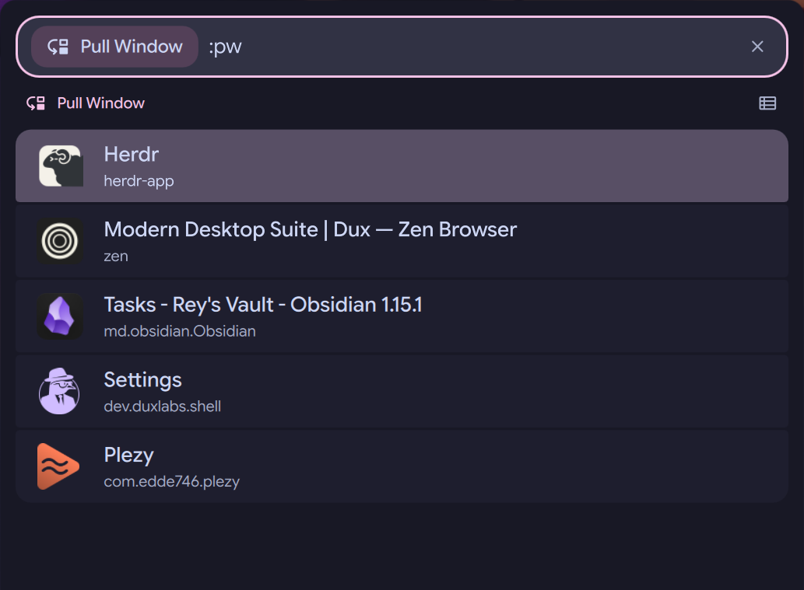

# Dux Shell Plugin: Pull Window

> This plugin has been tested on Sway, Scroll, MangoWC and niri, but Hyprland is my daily driver. If
> you run into any problems or have feedback, please
> [open an issue](https://github.com/ReyArlena/dux-pull-window/issues).

[Dux Shell](https://github.com/duxlabs-dev/dux-shell) launcher plugin that finds an open window and
pulls it onto the workspace you are on, on Hyprland, Sway, Scroll, MangoWC or niri. The opposite of
sending the active window away with SUPER + SHIFT + number.



Type the trigger, then part of a window title or app name:

```
:pw              every open window, most recently used first
:pw firefox      Firefox windows
:pw gh pr        windows whose class or title matches "gh" then "pr"
```

Choosing a window moves it to the workspace you are on and focuses it, without switching to the
window's own workspace, so it also works for windows on headless or virtual outputs you cannot
see. On Hyprland that is the active workspace of the focused monitor, or its special workspace
(scratchpad) when one is open there; on MangoWC it is the focused monitor's active tag. Choosing a
window that is already there just focuses it.

The list follows the compositor's window events, so new and closed windows show up straight away.
With nothing typed, windows are in most recently used order. Hyprland and niri keep their own focus
history; on Sway, Scroll and MangoWC it starts when the plugin loads, before that the list follows
the compositor's own window order.

## Why

I made this for when I'm connected to my PC remotely on a headless display (eg streaming with
Sunshine). You can pull windows that would otherwise be out of sight on other monitors or
workspaces onto the headless display you're using, or just use it for general window management.

## Keybinds

Bind a key to open the launcher straight in Pull Window mode. It uses whatever trigger is set.

```
dms ipc call pullWindow toggle     # opens it, or closes it when open
dms ipc call pullWindow open       # opens it
```

The examples use SUPER + P; pick any free key.

### Hyprland

In `hyprland.lua` (or a file it `require`s):

```lua
hl.bind("SUPER + P", hl.dsp.exec_cmd("dms ipc call pullWindow toggle"), { description = "Pull window" })
```

If SUPER + P is already bound (Dux Shell's default Hyprland binds use it), add
`hl.unbind("SUPER + P")` before it.

### Sway

In `~/.config/sway/config` (or a file it `include`s):

```
bindsym $mod+p exec dms ipc call pullWindow toggle
```

Reload with `swaymsg reload`.

### Scroll

In `~/.config/scroll/config` (or a file it `include`s):

```
bindsym $mod+p exec dms ipc call pullWindow toggle
```

Reload with `scrollmsg reload`.

### MangoWC

In `~/.config/mango/config.conf` (or a file it sources):

```
bind=SUPER,p,spawn,dms ipc call pullWindow toggle
```

### niri

In the `binds` section of `~/.config/niri/config.kdl`:

```kdl
Mod+P { spawn "dms" "ipc" "call" "pullWindow" "toggle"; }
```

## Requirements

- Dux Shell 2.0.0 or newer
- Hyprland 0.55 or newer with a Lua config (`hyprland.lua`; the plugin moves windows with the Lua
  dispatcher syntax) and `jq`, or
- Sway (uses `swaymsg`), or
- Scroll (uses `scrollmsg`), or
- MangoWC (uses `mmsg`), or
- niri (uses `niri msg`)

A startup check verifies the compositor, the tools and the Hyprland version when the plugin is
enabled; it does not check for a Lua config.

Miracle isn't supported for now. As of 0.11.1 its IPC doesn't report window titles, and moving a
window onto the workspace you're on either switches workspace or loses the window

labwc isn't supported either. It has no IPC, so the only way to bring a window forward from
outside is to activate it, which always switches to that window's workspace

## Install

### From the plugin registry

- In the app: Settings → Plugins → Browse, find Pull Window and install it
- From the CLI: `dms plugins install pullWindow`

Update later with `dms plugins update pullWindow`, or remove it with `dms plugins uninstall pullWindow`.

### Manually

```bash
git clone https://github.com/ReyArlena/dux-pull-window ~/.config/dms/plugins/dux-pull-window
dms ipc call plugin-scan scan
dms ipc call plugins enable pullWindow
```

## Configuration

DMS Settings → Plugins → Pull Window:

- **Trigger** - launcher prefix, default `:pw`. Applied with Save or Enter.

## License

MIT
